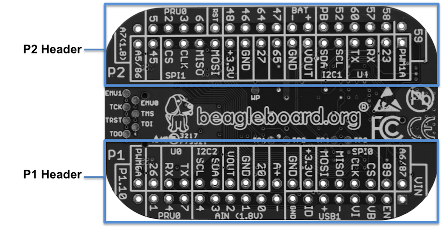

# PocketBeagle Software Repository

Development repository for the PocketBeagle (AM3358, SiP OSD3358-SM) board.

Board OS: BeagleBoard.org Debian 13 (trixie) Base Image, kernel
`6.18.55-bone57`, booted from eMMC (28 GB root, ~26 GB free, 481 MB RAM).

Reference manuals (datasheets, TRMs, PRU PDFs) live separately in
`D:\main-ti-db\PocketBeagle` (manual editing folder, not a repo).



## Board connection (verified working)

USB network gadget: board = `192.168.7.2/30`, Windows host = `192.168.7.1`
(adapter "Ethernet 4"). `~/.ssh/config`:

```
Host pocket
    HostName pocket.local
    User debian
    IdentityFile ~/.ssh/id_rsa_pocket
```

Works from Windows cmd or MSYS:

```
ssh pocket          # shell
scp file pocket:~/  # deploy
```

Default user is `debian` with passwordless sudo for some commands only
(LED sysfs works without sudo: the `debian` user is in the `gpio` group).
The board has **no internet access** by default (no default route) - `apt`
requires sharing the host's connection first, see
`docs/board_usb_network_share_guide.md`.

## Toolchains (all verified end-to-end)

### Cortex-A8 applications (Linux userspace)

| Where | Tool | Notes |
|---|---|---|
| On board | `gcc` 14.2 (Debian, arm-linux-gnueabihf) | `make`, `python3` 3.13, `git` also installed |
| Windows host | `D:\arm-none-linux-gnu-15.3.rel2\bin\arm-none-linux-gnueabihf-gcc.exe` 15.3.1 | cross, deploy via scp |

Native build on the board:

```
gcc -O2 -march=armv7-a -mfpu=neon -mfloat-abi=hard app.c -o app
```

Cross build on Windows (board glibc is Debian 13 / 2.41; if the binary fails
on board due to newer glibc symbols, build natively on board or use
`-static`):

```
D:\arm-none-linux-gnu-15.3.rel2\bin\arm-none-linux-gnueabihf-gcc.exe ^
  -O2 -march=armv7-a -mfpu=neon -mfloat-abi=hard app.c -o app
scp app pocket:~/
```

### PRU firmware (TI PRU Code Generation Tools 2.3.3)

Already installed on the board as Debian package `ti-pru-cgt-v2.3`
(`/usr/bin/clpru`, `/usr/share/ti/cgt-pru`); full set: `clpru lnkpru hexpru
asmpru dispru nmpru ofdpru ...`.

Windows host: installer extracted to
`D:\main-ti-db\PocketBeagle\ti-cgt-pru_2.3.3\` (verified:
`ti-cgt-pru_2.3.3\bin\clpru.exe` v2.3.3); the
`ti_cgt_pru_2.3.3_armlinuxa8hf_busybox_installer.sh` variant is redundant
(same CGT already on board).

Verified build flow for AM335x PRU (little-endian, EABI):

```
clpru -v2 -O2 --include_path=/usr/share/ti/cgt-pru/include -c fw.c
lnkpru --rom_model --search_path=/usr/share/ti/cgt-pru/lib \
       -o fw.out -l rtspruv2_le.lib fw.obj
```

**Gotcha:** `-v2` belongs to the *compiler* only. Passing `-v2` to `lnkpru`
is parsed as the obsolete COFF version option and fails with
`--coff_version=2 not supported when producing ELF output files`.

### PRU access mode on this board: UIO (not remoteproc)

`/boot/uEnv.txt` contains `uboot_overlay_pru=AM335X-PRU-UIO-00A0.dtbo`, so:

- PRUs are exposed as `/dev/uio0`..`/dev/uio7` = `pruss_evt0..7`
  (`uio_pruss` module loaded); the `debian` user is in the `users` group
  which owns those devices.
- `remoteproc0` is only `wkup_m3` (Cortex-M3 power management). There is **no
  `/dev/remoteproc/pruss-coreN` and no rpmsg** for the PRUs.
- Therefore the PRU Cookbook's "copy firmware to `/lib/firmware/am335x-pru0-fw`
  and start remoteproc" flow does **not** apply as-is. Load firmware from an
  A8 application via the UIO driver: use `libprussdrv`
  (`am335x_pru_package/pru_sw/app_loader`, compiles natively on board) or
  mmap `/dev/uio*` directly.
- Alternative: switch `uEnv.txt` to the RPROC overlay (and reboot) to follow
  the cookbook verbatim and gain rpmsg. `config-pin` is not installed either
  way (needs `apt`, needs internet).

## On-board LEDs

| LED | GPIO | Kernel LED name | Default role |
|---|---|---|---|
| USR0 | GPIO1_21 | `beaglebone:green:usr0` | heartbeat |
| USR1 | GPIO1_22 | `beaglebone:green:usr1` | microSD activity |
| USR2 | GPIO1_23 | `beaglebone:green:usr2` | CPU activity |
| USR3 | GPIO1_24 | `beaglebone:green:usr3` | idle (currently trigger `none`) |

Control: `echo none > /sys/class/leds/beaglebone:green:usr3/trigger`
then `echo 1|0 > .../brightness`. On this image both files are `root:gpio`
mode 664 and `debian` is in the `gpio` group, so no sudo is needed.
`app/blink_hello` does exactly this for USR3 and restores the previous
trigger on exit.

## Serial debug

UART0 on P1.30 (TX) / P1.32 (RX), 115200 8N1, when USB boot/console is not in
use.

## Pin tables (raw notes)

Note: GPIO44 is incorrectly labelled as GPIO48 in some references.

LED signals:

| LED | Signal | Proc Ball | SiP Ball |
|---|---|---|---|
| USR0 | GPIO1_21 | V15 | P13 |
| USR1 | GPIO1_22 | U15 | T14 |
| USR2 | GPIO1_23 | T15 | R14 |
| USR3 | GPIO1_24 | V16 | P14 |

PRU-capable pins (quick view):

| Header.Pin | Silkscreen | Proc Ball | SiP Ball | PRU Output (Mode5) | PRU Input (Mode6) |
|---|---|---|---|---|---|
| P1.02 | A6/87 | R5 | F2 | pr1_pru1_pru_r30_9 | pr1_pru1_pru_r31_9 |
| P1.04 | 89 | R6 | E1 | pr1_pru1_pru_r30_11 | pr1_pru1_pru_r31_11 |
| P1.20 | 20 | D14 | B4 | (mode4) pr1_pru0_pru_r31_16 | |
| P1.29 | PRU0_7 | A14 | C4 | pr1_pru0_pru_r30_7 | pr1_pru0_pru_r31_7 |
| P1.30 | U0_TX | E16 | B12 | pr1_pru1_pru_r30_15 | pr1_pru1_pru_r31_15 |
| P1.31 | PRU0_4 | B12 | A3 | pr1_pru0_pru_r30_4 | pr1_pru0_pru_r31_4 |
| P1.32 | U0_RX | E15 | A12 | pr1_pru1_pru_r30_14 | pr1_pru1_pru_r31_14 |
| P1.33 | PRU0_1 | B13 | A2 | pr1_pru0_pru_r30_1 | pr1_pru0_pru_r31_1 |
| P1.35 | P1.10 | V5 | F1 | pr1_pru1_pru_r30_10 | pr1_pru1_pru_r31_10 |
| P1.36 | PWM0A | A13 | A1 | pr1_pru0_pru_r30_0 | pr1_pru0_pru_r31_0 |
| P2.09 | I2C1_SCL | D15 | B11 | (mode4) pr1_uart0_txd | pr1_pru0_pru_r31_16 |
| P2.11 | I2C1_SDA | D16 | A11 | (mode4) pr1_uart0_rxd | pr1_pru1_pru_r31_16 |
| P2.17 | 65 | V12 | T7 | (mode4) pr1_mdio_mdclk | |
| P2.18 | 47 | U13 | P7 | (mode4) pr1_ecap0... | pr1_pru0_pru_r31_15 |
| P2.20 | 64 | T13 | R7 | (mode4) pr1_mdio_data | |
| P2.22 | 46 | V13 | T6 | | pr1_pru0_pru_r31_14 |
| P2.24 | 48 | T12 | P6 | pr1_pru0_pru_r30_14 | |
| P2.28 | PRU0_6 | D13 | C3 | pr1_pru0_pru_r30_6 | pr1_pru0_pru_r31_6 |
| P2.30 | PRU0_3 | C12 | B1 | pr1_pru0_pru_r30_3 | pr1_pru0_pru_r31_3 |
| P2.31 | SPI1_CS | A15 | A4 | | pr1_pru1_pru_r31_16 |
| P2.32 | PRU0_2 | D12 | B2 | pr1_pru0_pru_r30_2 | pr1_pru0_pru_r31_2 |
| P2.33 | 45 | R12 | R6 | pr1_pru0_pru_r30_15 | |
| P2.34 | PRU0_5 | C13 | B3 | pr1_pru0_pru_r30_5 | pr1_pru0_pru_r31_5 |
| P2.35 | A5/86 | U5 | F3 | pr1_pru1_pru_r30_8 | pr1_pru1_pru_r31_8 |

Full mode-0..7 pinmux table (all header pins):

```
Header.Pin  Silkscreen  PocketBeagle wiring   Proc Ball  SiP Ball  Mode0 (Name)      Mode1            Mode2        Mode3                    Mode4                Mode5                 Mode6                 Mode7
P1.01       VIN         P1.01 (VIN)                      P10&R10&T10  VIN
P1.02       A6/87       P1.02 (AIN6/GPIO87)   A8         C9        ain6
P1.02       A6/87       P1.02 (AIN6/GPIO87)   R5         F2        lcd_hsync         gpmc_a9          gpmc_a2      pr1_edio_data_in3        pr1_edio_data_out3   pr1_pru1_pru_r30_9    pr1_pru1_pru_r31_9    gpio2_23
P1.03       USB1_EN     P1.03 (USB1-DRVVBUS)  F15        M14       USB1_DRVVBUS                                                                                                                   gpio3_13
P1.04       89          P1.04 (PRU1.11)       R6         E1        lcd_ac_bias_en    gpmc_a11         pr1_mii1_crs pr1_edio_data_in5        pr1_edio_data_out5   pr1_pru1_pru_r30_11   pr1_pru1_pru_r31_11   gpio2_25
P1.05       USB1_VB     P1.05 (USB1-VBUS)     T18        M15       USB1_VBUS
P1.06       SPI0_CS     P1.06 (SPI0-CS)       A16        A14       spi0_cs0          mmc2_sdwp        I2C1_SCL     ehrpwm0_synci            pr1_uart0_txd        pr1_edio_data_in1     pr1_edio_data_out1    gpio0_5
P1.07       USB1_VI     P1.07 (VIN-USB)                  P9&R9&T9  VIN-USB
P1.08       SPI0_CLK    P1.08 (SPI0-CLK)      A17        A13       spi0_sclk         uart2_rxd        I2C2_SDA     ehrpwm0A                 pr1_uart0_cts_n      pr1_edio_sof          EMU2                  gpio0_02
P1.09       USB1-       P1.09 (USB1-DN)       R18        L16       USB1_DM
P1.10       SPI0_MISO   P1.10 (SPI0-MISO)     B17        B13       spi0_d0           uart2_txd        I2C2_SCL     ehrpwm0B                 pr1_uart0_rts_n      pr1_edio_latch_in     EMU3                  gpio0_3
P1.11       USB1+       P1.11 (USB1-DP)       R17        L15       USB1_DP
P1.12       SPI0_MOSI   P1.12 (SPI0-MOSI)     B16        B14       spi0_d1           mmc1_sdwp        I2C1_SDA     ehrpwm0_tripzone_input   pr1_uart0_rxd        pr1_edio_data_in0     pr1_edio_data_out0    gpio0_04
P1.13       USB1_ID     P1.13 (USB1-ID)       P17        L14       USB1_ID
P1.14                   P1.14 (VOUT-3.3V)                F6&F7&G6&G7  VOUT-3.3V
P1.15       USB1_GND    P1.15 (GND)                                GND
P1.16       GND         P1.16 (GND)                                GND
P1.17       AIN(1.8V)-  P1.17 (VREFN)         A9         B9        VREFN
P1.18       AIN(1.8V)A+ P1.18 (VREFP)         B9         B7        VREFP
P1.19       AIN(1.8V)0  P1.19 (AIN0-1.8V)     B6         A8        ain0
P1.20       20          P1.20 (PRU0.16)       D14        B4        xdma_event_intr1                   tclkin       clkout2                  timer7               pr1_pru0_pru_r31_16   EMU3                  gpio0_20
P1.21       AIN(1.8V)1  P1.21 (AIN1-1.8V)     C7         B8        ain1
P1.22       GND         P1.22 (GND)                                GND
P1.23       AIN(1.8V)2  P1.23 (AIN2-1.8V)     B7         B6        ain2
P1.24       VOUT        P1.24 (VOUT-5V)                  K6&K7&L6&L7  VOUT-5V
P1.25       AIN(1.8V)3  P1.25 (AIN3-1.8V)     A7         C6        ain3
P1.26       I2C2_SDA    P1.26 (I2C2-SDA)      D18        B10       uart1_ctsn        timer6           dcan0_tx     I2C2_SDA                 spi1_cs0             pr1_uart0_cts_n       pr1_edc_latch0_in     gpio0_12
P1.27       AIN(1.8V)4  P1.27 (AIN4-1.8V)     C8         C7        ain4
P1.28       I2C2_SCL    P1.28 (I2C2-SCL)      D17        A10       uart1_rtsn        timer5           dcan0_rx     I2C2_SCL                 spi1_cs1             pr1_uart0_rts_n       pr1_edc_latch1_in     gpio0_13
P1.29       PRU0_7      P1.29 (PRU0.7)        A14        C4        mcasp0_ahclkx     eQEP0_strobe     mcasp0_axr3  mcasp1_axr1              EMU4                 pr1_pru0_pru_r30_7    pr1_pru0_pru_r31_7    gpio3_21
P1.30       U0_TX       P1.30 (UART0-TX)      E16        B12       uart0_txd         spi1_cs1         dcan0_rx     I2C2_SCL                 eCAP1_in_PWM1_out    pr1_pru1_pru_r30_15   pr1_pru1_pru_r31_15   gpio1_11
P1.31       PRU0_4      P1.31 (PRU0.4)        B12        A3        mcasp0_aclkr      eQEP0A_in        mcasp0_axr2  mcasp1_aclkx             mmc0_sdwp            pr1_pru0_pru_r30_4    pr1_pru0_pru_r31_4    gpio3_18
P1.32       U0_RX       P1.32 (UART0-RX)      E15        A12       uart0_rxd         spi1_cs0         dcan0_tx     I2C2_SDA                 eCAP2_in_PWM2_out    pr1_pru1_pru_r30_14   pr1_pru1_pru_r31_14   gpio1_10
P1.33       PRU0_1      P1.33 (PRU0.1)        B13        A2        mcasp0_fsx        ehrpwm0B                      spi1_d0                  mmc1_sdcd            pr1_pru0_pru_r30_1    pr1_pru0_pru_r31_1    gpio3_15
P1.34       26          P1.34 (GPIO0.26)      T11        R5        gpmc_ad10         lcd_data21       mmc1_dat2    mmc2_dat6                ehrpwm2_tripzone_in  pr1_mii0_txen                               gpio0_26
P1.35       P1.10       P1.35 (PRU1.10)       V5         F1        lcd_pclk          gpmc_a10         pru_mii0_crs pr1_edio_data_in4        pr1_edio_data_out4   pr1_pru1_pru_r30_10   pr1_pru1_pru_r31_10   gpio2_24
P1.36       PWM0A       P1.36 (PWM0A)         A13        A1        mcasp0_aclkx      ehrpwm0A                      spi1_sclk                mmc0_sdcd            pr1_pru0_pru_r30_0    pr1_pru0_pru_r31_0    gpio3_14

Header.Pin  Silkscreen  PocketBeagle wiring   Proc Ball  SiP Ball  Mode0 (Name)      Mode1            Mode2        Mode3                    Mode4                Mode5                 Mode6                 Mode7
P2.01       PWM1A       P2.01 (PWM1A)         U14        P12       gpmc_a2           gmii2_txd3       rgmii2_td3   mmc2_dat1                gpmc_a18             pr1_mii1_txd2         ehrpwm1A              gpio1_18
P2.02       59          P2.02 (GPIO1.27)      V17        T16       gpmc_a11          gmii2_rxd0       rgmii2_rd0   rmii2_rxd0               gpmc_a27             pr1_mii1_rxer         mcasp0_axr1           gpio1_27
P2.03       23          P2.03 (GPIO0.23)      T10        P5        gpmc_d9           lcd_data22       mmc1_dat1    mmc2_dat5                ehrpwm2B             pr1_mii0_col                                gpio0_23
P2.04       58          P2.04 (GPIO1.26)      T16        R15       gpmc_a10          gmii2_rxd1       rgmii2_rd1   rmii2_rxd1               gpmc_a26             pr1_mii1_rxdv         mcasp0_axr0           gpio1_26
P2.05       U1_RX       P2.05 (UART4-RX)      T17        P15       gpmc_wait0        gmii2_crs        gpmc_csn4    rmii2_crs_dv             mmc1_sdcd            pr1_mii1_col          uart4_rxd             gpio0_30
P2.06       57          P2.06 (GPIO1.25)      U16        T15       gpmc_a9           gmii2_rxd2       rgmii2_rd2   mmc2_dat7/rmii2_crs_dv   gpmc_a25             pr1_mii_mr1_clk       mcasp0_fsx            gpio1_25
P2.07       U1_TX       P2.07 (UART4-TX)      U17        R16       gpmc_wp           gmii2_rxerr      gpmc_csn5    rmii2_rxerr              mmc2_sdcd            pr1_mii1_txen         uart4_txd             gpio0_31
P2.08       60          P2.08 (GPIO1.28)      U18        N14       gpmc_be1n         gmii2_col        gpmc_csn6    mmc2_dat3                gpmc_dir             pr1_mii1_rxlink       mcasp0_aclkr          gpio1_28
P2.09       I2C1_SCL    P2.09 (I2C1-SCL)      D15        B11       uart1_txd         mmc2_sdwp        dcan1_rx     I2C1_SCL                                      pr1_uart0_txd         pr1_pru0_pru_r31_16   gpio0_15
P2.10       52          P2.10 (GPIO1.20)      R14        R13       gpmc_a4           gmii2_txd1       rgmii2_td1   rmii2_txd1               gpmc_a20             pr1_mii1_txd0         eQEP1A_in             gpio1_20
P2.11       I2C1_SDA    P2.11 (I2C1-SDA)      D16        A11       uart1_rxd         mmc1_sdwp        dcan1_tx     I2C1_SDA                                      pr1_uart0_rxd         pr1_pru1_pru_r31_16   gpio0_14
P2.12       PB          P2.12 (POWER_BTN)                T11       POWER
P2.13       VOUT        P2.13 (VOUT-5V)                  K6,K7,L6,L7  VOUT-5V
P2.14       BAT+        P2.14 (VIN-BAT)                  P8,R8,T8  VIN-BAT
P2.15       GND         P2.15 (GND)                                GND
P2.16       BAT-        P2.16 (BAT-TEMP)                 N6        BAT-TEMP
P2.17       65          P2.17 (GPIO2.1)       V12        T7        gpmc_clk          lcd_memory_clk   gpmc_wait1   mmc2_clk                 pr1_mii1_crs         pr1_mdio_mdclk        mcasp0_fsr            gpio2_01
P2.18       47          P2.18 (PRU0.15i)      U13        P7        gpmc_ad15         lcd_data16       mmc1_dat7    mmc2_dat3                eQEP2_strobe         pr1_ecap0_ecap_...    pr1_pru0_pru_r31_15   gpio1_15
P2.19       27          P2.19 (GPIO0.27)      U12        T5        gpmc_ad11         lcd_data20       mmc1_dat3    mmc2_dat7                ehrpwm0_synco        pr1_mii0_txd3                               gpio0_27
P2.20       64          P2.20 (GPIO2.0)       T13        R7        gpmc_csn3         gpmc_a3          rmii2_crs_dv mmc2_cmd                 pr1_mii0_crs         pr1_mdio_data         EMU4                  gpio2_00
P2.21       GND         P2.21 (GND)                                GND
P2.22       46          P2.22 (GPIO1.14)      V13        T6        gpmc_ad14         lcd_data17       mmc1_dat6    mmc2_dat2                eQEP2_index          pr1_mii0_txd0         pr1_pru0_pru_r31_14   gpio1_14
P2.23                   P2.23 (VOUT-3.3V)                F6&F7&G6&G7  VOUT-3.3V
P2.24       48          P2.24 (GPIO1.12)      T12        P6        gpmc_ad12         lcd_data19       mmc1_dat4    mmc2_dat0                eQEP2A_in            pr1_mii0_txd2         pr1_pru0_pru_r30_14   gpio1_12
P2.25       SPI1_MOSI   P2.25 (SPI1-MOSI)     E17        C13       uart0_rtsn        uart4_txd        dcan1_rx     I2C1_SCL                 spi1_d1              spi1_cs0              pr1_edc_sync1_out     gpio1_09
P2.26       RST         P2.26 (NRESET)        A10        R11       nRESETIN_OUT
P2.27       SPI1_MISO   P2.27 (SPI1-MISO)     E18        C12       uart0_ctsn        uart4_rxd        dcan1_tx     I2C1_SDA                 spi1_d0              timer7                pr1_edc_sync0_out     gpio1_08
P2.28       PRU0_6      P2.28 (PRU0.6)        D13        C3        mcasp0_axr1       eQEP0_index                   mcasp1_axr0              EMU3                 pr1_pru0_pru_r30_6    pr1_pru0_pru_r31_6    gpio3_20
P2.29       SPI1_CLK    P2.29 (SPI1-CLK)      C18        C5        eCAP0_in_PWM0_out uart3_txd        spi1_cs1     pr1_ecap0_ecap_...       spi1_sclk            mmc0_sdwp             xdma_event_intr2      gpio0_7
P2.30       PRU0_3      P2.30 (PRU0.3)        C12        B1        mcasp0_ahclkr     ehrpwm0_synci    mcasp0_axr2  spi1_cs0                 eCAP2_in_PWM2_out    pr1_pru0_pru_r30_3    pr1_pru0_pru_r31_3    gpio3_17
P2.31       SPI1_CS     P2.31 (SPI1-CS1)      A15        A4        xdma_event_intr0  timer4           clkout1      spi1_cs1                                      pr1_pru1_pru_r31_16   EMU2                  gpio0_19
P2.32       PRU0_2      P2.32 (PRU0.2)        D12        B2        mcasp0_axr0       ehrpwm0_tripzone              spi1_d1                  mmc2_sdcd            pr1_pru0_pru_r30_2    pr1_pru0_pru_r31_2    gpio3_16
P2.33       45          P2.33 (GPIO1.13)      R12        R6        gpmc_ad13         lcd_data18       mmc1_dat5    mmc2_dat1                eQEP2B_in            pr1_mii0_txd1         pr1_pru0_pru_r30_15   gpio1_13
P2.34       PRU0_5      P2.34 (PRU0.5)        C13        B3        mcasp0_fsr        eQEP0B_in        mcasp0_axr3  mcasp1_fsx               EMU2                 pr1_pru0_pru_r30_5    pr1_pru0_pru_r31_5    gpio3_19
P2.35       A5/86       P2.35 (AIN5/GPIO86)   B8         C8        ain5
P2.35       A5/86       P2.35 (AIN5/GPIO86)   U5         F3        lcd_vsync         gpmc_a8          gpmc_a1      pr1_edio_data_in2        pr1_edio_data_out2   pr1_pru1_pru_r30_8    pr1_pru1_pru_r31_8    gpio2_22
P2.36       A7(1.8)     P2.36 (AIN7)          N13                  ain7
```

## References

- PRUSSv2 overview: <https://elinux.org/Ti_AM33XX_PRUSSv2>
- PRU Cookbook, running programs & pins:
  <https://docs.beagleboard.org/books/pru-cookbook/03details/details.html>
  (note: assumes the RPROC overlay - this board uses UIO, see above)
- TI AM335x TRM: `spruh73q.pdf` (manual folder), PRU compiler:
  `spruhv7c.pdf`, assembly tools: `spruhv6c.pdf`
